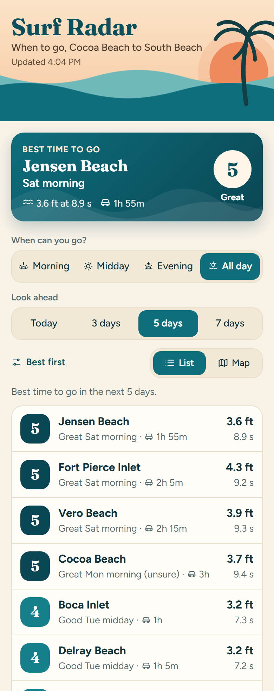
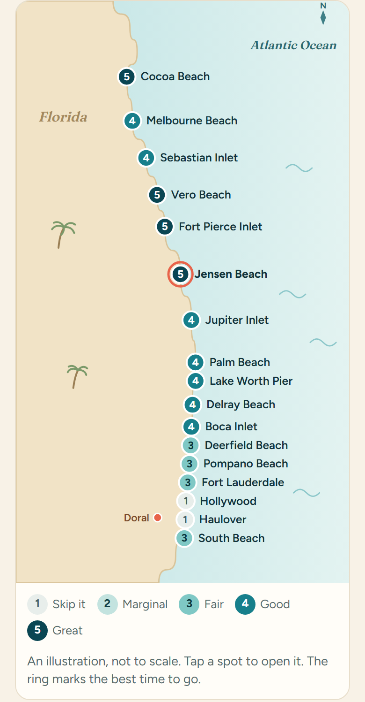
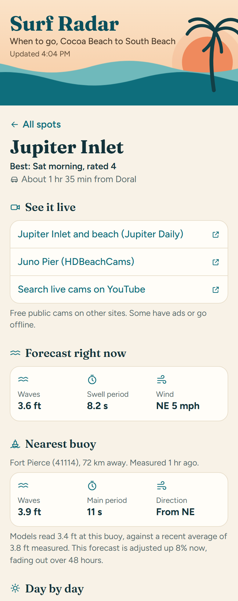

# Surf Radar

**Live site: [adriancal19.github.io/surf-radar](https://adriancal19.github.io/surf-radar/)**

A free surf forecast for 17 spots on Florida's east coast, from Cocoa Beach to South Beach. It answers one question: when is it worth making the drive?

I don't get to surf often, so a wasted trip costs me a lot. I wanted something that tells me the best time to go based on my own preferences, without paying for a subscription.

<table>
  <tr>
    <td valign="top"></td>
    <td valign="top"></td>
    <td valign="top"></td>
  </tr>
</table>

## What it does

- **Names the best time to go**, based on when you're free, how far ahead you're looking (or the exact days you pick) and how far you'll drive.
- **Rates each spot from 1 to 5** for morning, midday and evening, using my preferences for wave size and swell period.
- **Labels its confidence**, based on how far ahead the day is and how much the forecast models disagree.
- **Checks against live buoys**, showing what the nearest buoy is measuring next to the forecast.
- **Warns about wind** that could spoil a session, and flags tropical systems that could send swell.
- **Sends a daily email** when a spot is forecast at 4 or higher three days out.
- **Links to free public cams** so you can see the conditions before leaving.

## How it works

```text
Three wave models
       |
       v
Blend (middle value)
       |
       v
Buoy correction  <---  NOAA buoys  (saved hourly by a GitHub job)
       |
       v
Rate each time of day
       |
       +--> Website  <---  Hurricane Center  (saved hourly by a GitHub job)
       |
       +--> Daily alert email
```

There's no server. The site is plain HTML, CSS and JavaScript on GitHub Pages, and your browser pulls the forecast directly from Open-Meteo. NOAA's buoy and hurricane feeds can't be read from a browser, so scheduled GitHub Actions save them as small data files on a separate branch. Everything runs on free tiers.

## Engineering decisions

**Testing the data before trusting it.** I compared the models live across all 17 spots before choosing any. ECMWF, my first pick, returns no swell period at all, and GWAM read 3.5–4.2 ft across South Florida where the others read about 2 ft, which suggests it misses the swell blocked by the Bahamas. I dropped GWAM and kept ECMWF for wave height only.

**Using the middle value.** With three models, a median ignores one bad outlier where an average wouldn't. Blending also fixed a suspicious result: one model alone had Cocoa Beach at 1.9 ft while the others read 3.2 ft or more.

**Comparing like with like.** Forecast points and buoys are in different places, so comparing a spot's forecast directly to a buoy would mix location differences with forecast error. The correction instead compares each buoy with the models at the buoy's own location, then applies the difference to nearby spots.

**Limiting how far a correction reaches.** A buoy says little about next week, or about a beach 100 km away. The adjustment fades to nothing over 48 hours, weakens with distance and is capped at 30%, so one odd reading can't swing the forecast. Three-day alerts aren't affected by it at all.

**Tuning from results.** The first rating rules made 3 ft days "Great" once blending raised the swell periods. The numbers showed the period bonus was too strong, so I cut it in half. Every rating rule lives in one settings file, so changes like that take one line.

**Recommending only what's reachable.** An early version suggested a spot "this evening" at 3:30 pm, even though the drive would end around sunset. Today's times now count only if you could get there with 90 minutes left to surf.

**Cutting a feature.** I planned a session log to calibrate ratings against real trips. Since it needs regular sessions per spot to mean anything, and I rarely go, I skipped it and built the "best time to go" answer and cam links instead.

## Known limitations

- **Heights are modeled offshore**, usually 12–22 km out on most of this coast, so they aren't what breaks at the beach. Comparisons between spots at different distances from shore can mislead.
- **Ratings aren't fully tuned yet.** They rest on my starting preferences and need checking against more real sessions.
- **Drive times are estimates** without traffic, calibrated to a single real-world trip.
- **Cam links can go stale**, because they point to other people's sites. Each spot also has a live YouTube search as a fallback.

## Project layout

```
index.html, styles.css       the page
settings.js                  rating rules, models and thresholds
spots.js, buoys.js           spots, buoys, drive times and cam links
src/pipeline.js              runs fetch → blend → correct → rate → label
src/blend.js                 combines models and measures disagreement
src/correction.js            live buoy correction
src/rating.js                the 1–5 score
src/confidence.js            confidence labels
src/filters.js               sorting, filters and the best time to go
src/alerts.js                what to email and what it says
src/map.js, src/app.js       draws the map and the page
src/sources/                 Open-Meteo, NDBC and NHC data
scripts/                     code the scheduled GitHub jobs run
.github/workflows/           the schedules
tests/tests.html             the test suite
```

## Run it

The page uses JavaScript modules, which browsers won't load from a file opened directly, so it needs a small local server:

1. Install the **Live Server** extension in VS Code.
2. Open this folder, right-click `index.html` and choose **Open with Live Server**.

To run the tests, open `tests/tests.html` the same way. They run in the browser, with no install or build step.

Email alerts need three GitHub secrets: `RESEND_API_KEY`, `ALERT_FROM` and `ALERT_TO`. Without them, the daily job only previews what it would send.

## Credits

- Weather and marine data by [Open-Meteo.com](https://open-meteo.com/), licensed under [CC BY 4.0](https://creativecommons.org/licenses/by/4.0/). This data is free for non-commercial use, so this project is non-commercial.
- Buoy readings from [NOAA NDBC](https://www.ndbc.noaa.gov/) and tropical systems from the [National Hurricane Center](https://www.nhc.noaa.gov/).
- Drive times based on road distances from [OSRM](https://project-osrm.org/), using map data © [OpenStreetMap](https://www.openstreetmap.org/copyright) contributors.
